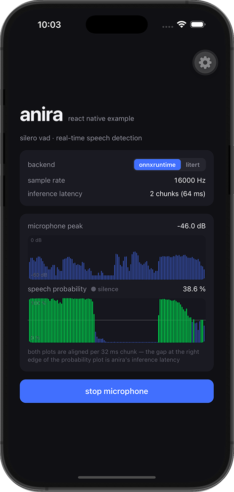

# anira mobile example

A React Native app running [anira](https://github.com/anira-project/anira) on **Android and iOS**:
any example of this repository (`effects/<name>/Example.h`) between the microphone and the output,
and the same example as an **AUv3** effect on iOS. By default the app runs `silero-vad`, Silero VAD
from [anira-project/models](https://github.com/anira-project/models) as a speech gate.



## Choosing the example

`app.json`, `expo.extra.anira`:

```json
"anira": {
  "example": "silero-vad",
  "auName": "anira: Silero VAD",
  "auDescription": "Silero VAD speech gate",
  "auSubtype": "svad"
}
```

`example` is any folder under `effects/` (`guitar-lstm`, `steerable-nafx`, `rave-funk-drum`, …);
the native build reads it, fetches that example's weights from Hugging Face and compiles them in.
The `au*` entries name the AUv3 (`auSubtype`: four characters). Run `npx expo prebuild` after a
change.

## Architecture

```
App.tsx  →  NativeAniraJSI (C++ TurboModule)  →  tanh-lib AudioDeviceManager (duplex)
                                                    └─ ExampleHost
                                                         └─ ExampleEngine  →  the example  →  anira  →  ONNX Runtime / LiteRT
```

| Path | Target | Role |
|------|--------|------|
| `CMakeLists.txt` | — | The native build: the chosen example through the repository's `anira_example()` (models from the `models/` submodule), tanh-lib's AudioIO, the targets below |
| `native/host/` | `processor_host` | `ExampleEngine`: the example the way every target runs it (its parameters, the backend choice with anira's real-time verdict and "Try nonetheless", dry/wet with the dry signal delayed by the latency, its meters, timelines for the UI); `ExampleHost`: the audio device's duplex callback around it |
| `native/jsi/` | — | TurboModule (TS spec, C++ impl, podspec, Expo config plugin) |
| `native/auv3/` | `anira_auv3` | iOS AUv3: `AniraAudioUnit` over the same engine (its parameter tree from the example), the extension's view controller (controls built from the tree) and the Expo config plugin that adds the app-extension target |
| `native/scripts/build-ios-libs.sh` | — | Builds the native side for the active Xcode platform and stages one library, `libanira_mobile.a`, with its headers and compile definitions |
| `App.tsx` | — | UI built from the example: backend choice, a slider per parameter, dry/wet, the input peak and a graph per meter |

## AUv3 plugin (iOS)

The iOS app also bundles the example as an **AUv3 effect** (`aufx`, `auSubtype`, manufacturer
`Anir`). There is no separate build: `native/auv3/ConfigureAUv3.js` adds an app-extension target to
the prebuild-generated Xcode project, so every iOS build embeds `AniraAUv3.appex` into the app.
Install and launch the app once and the plugin shows up in hosts (AUM, GarageBand, …).

- **Parameters and state** are native AUv3: the `AUParameterTree` holds the example's parameters,
  Backend, Dry/Wet, Try nonetheless and the example's meters (read-only). `AUAudioUnit`'s default
  `fullState` persists the tree, so host sessions and user presets need no extra code.
- The example runs at the host's rate and block size and reports its latency to the host.
- Device builds need a signing team for both targets — set `expo.ios.appleTeamId` in `app.json`.

## Build & run

From the examples repository (the `models/` submodule must be checked out). Requires Node 18+,
CMake on `PATH`, Xcode 15+ (iOS) or Android Studio with the NDK (Android).

```bash
git submodule update --init
cd targets/mobile
npm install
npx expo prebuild

npx expo run:ios        # or: npx expo run:android
```

`ANIRA_MOBILE_CMAKE_ARGS` passes extra CMake arguments to the iOS build (for example
`-DFETCHCONTENT_SOURCE_DIR_ANIRA=/path/to/anira` for a local anira).

## Resources

- [anira](https://github.com/anira-project/anira) — real-time neural network inference
- [anira-project/models](https://github.com/anira-project/models) — the models and their weights
- [tanh-lib](https://github.com/tanh-lab/tanh-lib) — audio device I/O, built on [miniaudio](https://github.com/mackron/miniaudio)

## License

The sources are [Apache-2.0](../../LICENSE). The app links tanh-lib's AudioIO, which is AGPL-3.0, so
a built app is under the AGPL-3.0. Model weights keep their upstream licences (RAVE's are
CC BY-NC 4.0).
